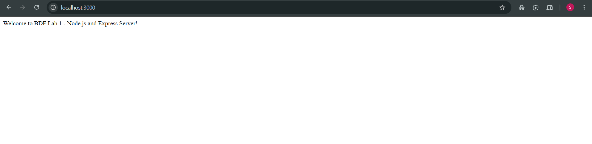
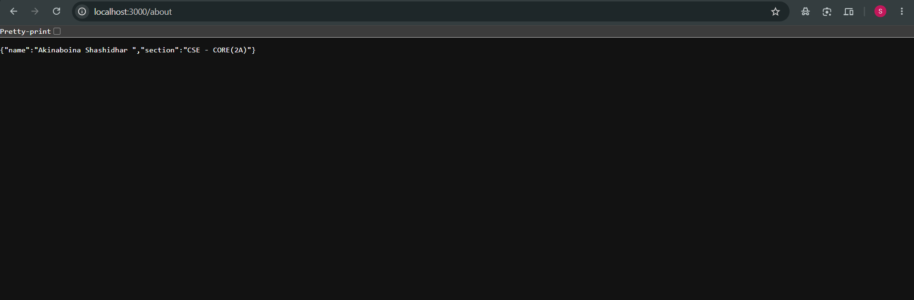
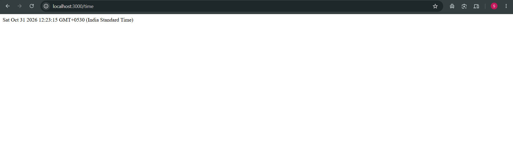
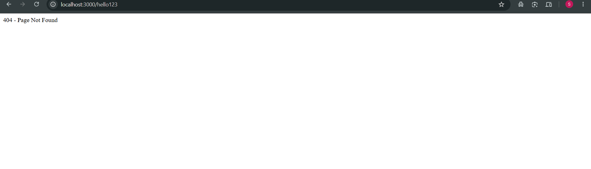

# BDF Lab 01 – Node.js and Express Server

**Student Name:** Akinaboina Shashidhar  
**Registration Number:** 252U1R1005  
**Section:** CSE-2A  
**Course:** Backend Development Fundamentals  
**Lab:** Lab 01 – Node.js and Express Server  
**Deployment Status:** Not Deployed , tested in local
**GitHub Repository:** https://github.com/shashidhary036-cell/Akinaboina-Shashidhar-

---

## 1. Introduction

This project was developed as part of the Backend Development Fundamentals (BDF) course. The purpose of this lab is to understand the fundamentals of backend development using Node.js and Express.js.

The project demonstrates the creation of a basic HTTP server using Node.js's built-in HTTP module and an Express application that handles multiple HTTP requests through different routes. It also demonstrates sending text and JSON responses, generating dynamic date and time information, and handling invalid URLs.

## 2. Objectives

- Understand the fundamentals of Node.js and backend development.
- Initialize a Node.js project using npm.
- Install and configure Express.js.
- Create a basic HTTP server using the built-in HTTP module.
- Implement multiple GET routes using Express.
- Display text and JSON responses.
- Generate dynamic date and time responses.
- Handle invalid URLs using HTTP status code 404.
- Understand HTTP request and response handling.
- Upload and manage project files using Git and GitHub.

## 3. Technologies Used

- **Node.js:** JavaScript runtime environment.
- **Express.js:** Backend web framework.
- **JavaScript:** Programming language.
- **npm:** Node Package Manager.
- **Visual Studio Code:** Code editor.
- **Git and GitHub:** Version control and repository hosting.

## 4. Project Structure

```text
Akinaboina-Shashidhar-/
├── Lab_1/
│   ├── .gitignore
│   ├── http-server.js
│   ├── server.js
│   ├── package.json
│   └── package-lock.json
├── Screenshots/
│   ├── Home.png
│   ├── About.png
│   ├── Time.png
│   └── Unknown.png
└── README.md
```

**Note:** The `node_modules` folder is excluded from GitHub using `.gitignore`. Dependencies can be installed locally using `npm install`.

## 5. Installation and Setup

### Prerequisites

Ensure that the following software is installed:

- Node.js
- npm (included with Node.js)
- Git
- Visual Studio Code or another code editor

### Step 1: Clone the GitHub repository

```bash
git clone https://github.com/shashidhary036-cell/Akinaboina-Shashidhar-.git
```

### Step 2: Navigate to the project folder

```bash
cd Akinaboina-Shashidhar-/Lab_1
```

### Step 3: Install dependencies

```bash
npm install
```

This command installs the dependencies listed in `package.json`.

## 6. Execution

### Running the Basic Node.js HTTP Server

Run the following command:

```bash
node http-server.js
```

Open the browser and visit:

http://localhost:3000

**Expected Output:**

```text
Hello
```

Stop the server using `Ctrl + C` before starting the Express server because both applications use port 3000.

### Running the Express Server

Run the following command:

```bash
node server.js
```

The Express application will listen for incoming HTTP requests on port 3000.

**Server URL:** http://localhost:3000

## 7. API Endpoints

The Express application provides the following GET endpoints:

| Method | Endpoint | Description | Status Code |
|---|---|---|---|
| GET | `/` | Displays a welcome message | 200 |
| GET | `/about` | Returns student information in JSON format | 200 |
| GET | `/time` | Displays the current date and time | 200 |
| GET | `/unknown` | Displays a page-not-found message | 404 |

Any unrecognized route should return a 404 response.

## 8. Output Screenshots

### 8.1 Home Route

The home route displays a welcome message.



### 8.2 About Route

The about route returns student information in JSON format.



### 8.3 Time Route

The time route displays the current system date and time.



### 8.4 Unknown Route

An invalid URL returns a custom 404 response.



## 9. Testing

The Express application was tested locally using a web browser.

The following functionalities were checked:

1. The home route returns a successful response.
2. The about route displays student information in JSON format.
3. The time route returns the current date and time.
4. Invalid routes return a 404 response.

## 10. Problems Faced and Solutions

### Problem 1: PowerShell Execution Policy Error

**Problem:** PowerShell restricted the execution of npm scripts.

**Solution:** Updated the execution policy for the current user to allow locally created scripts.

### Problem 2: GitHub Push Error

**Problem:** The initial Git push failed because the project files had not been committed successfully.

**Solution:** Added the files using `git add .`, created a commit, and pushed the changes to GitHub.

### Problem 3: GitHub Folder Showing 404

**Problem:** The `Lab_1` folder was initially tracked as a nested Git repository.

**Solution:** Corrected the repository structure so that `Lab_1` was tracked as a regular folder.

### Problem 4: Port Already in Use

**Problem:** Both the Node.js HTTP server and Express server use port 3000.

**Solution:** Stopped the running server using `Ctrl + C` before starting the other server.

## 11. Important Notes

- The project was developed using Visual Studio Code.
- Node.js and Express.js were used for backend development.
- The application runs locally on port 3000.
- Express dependencies are managed through npm.
- The `node_modules` folder should not be uploaded to GitHub.
- Screenshots are stored in the `Screenshots` folder.
- Public deployment has not been performed.

## 12. Conclusion

Through this lab, I gained practical knowledge of Node.js and Express.js. I learned how to initialize a backend project, install dependencies, create an HTTP server, implement API routes, send different HTTP responses, and handle invalid requests.

This experiment helped me understand the fundamentals of backend development and the importance of version control using Git and GitHub.
